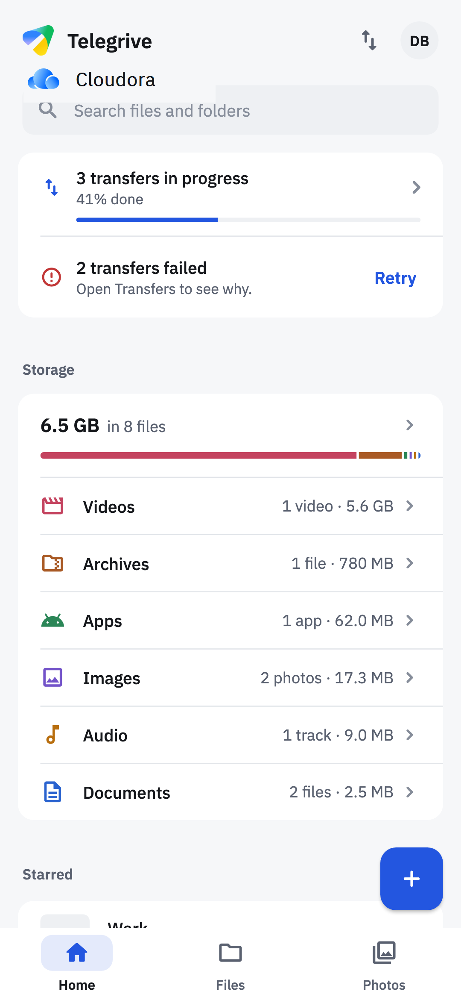
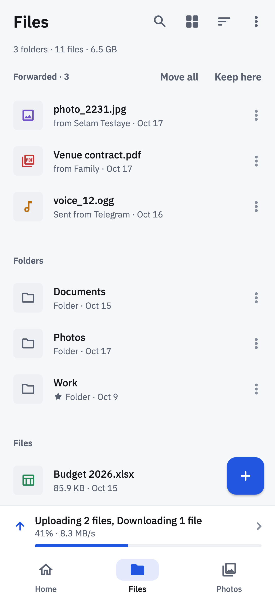
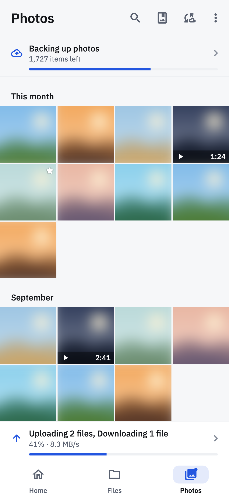
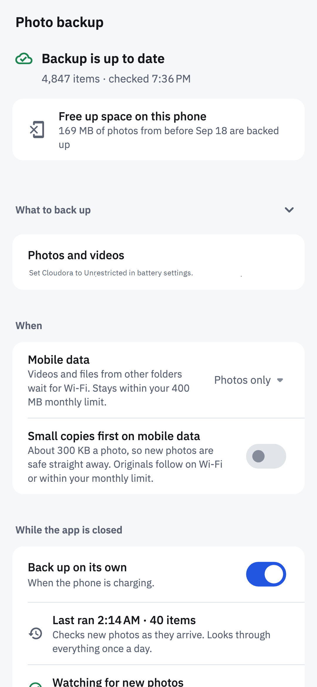

# Cloudora

Use your Telegram account as a drive with no storage limit, and back up
your photos to it.

Cloudora keeps your files in a private channel in your own Telegram
account and gives you a simple file manager for them. There is no new
account to make and no Cloudora server: you sign in with Telegram, and
your files stay in Telegram.

**Website and downloads: [protechph.github.io/Cloudora](https://protechph.github.io/Cloudora/)**

## What it does

- **Keeps as much as you like,** with files of any size.
- **Backs up your photos** in full quality. Turn it on once and new photos
  follow by themselves, or upload one album from your gallery. Then free
  up space on your phone.
- **Brings over Google Photos,** with dates and albums.
- **Works like a file manager:** folders, stars, albums, and a trash you
  can undo.
- **Shares the drive with your family.** Everyone signs in with their own
  Telegram and sees the same files; you decide who can add and change them.
- **Finds things** by name, by date, or by the words inside a document.
- **Plays videos and music and opens PDFs** without downloading them
  first.
- **Works offline.** Changes you make reach Telegram when you are back
  online.
- **Goes easy on mobile data.** Big uploads can wait for Wi-Fi.
- **Stays private,** with a fingerprint or face lock, and a Private space
  for folders only you should see. Any folder can also stay out of Photos.

## Getting started

1. **Android:** download Cloudora from
   [the website](https://protechph.github.io/Cloudora/#install) and open
   the file. Most phones need the file ending in `arm64-v8a.apk`.
   **iPhone:** follow the
   [iPhone guide](https://protechph.github.io/Cloudora/iphone.html). You
   install Cloudora with a free helper app and your Apple Account.
   Cloudora isn't in Google Play or the App Store yet.
2. Sign in with your Telegram phone number, or scan a QR code from
   Telegram on another device.
3. Cloudora sets up its channel for you and offers to back up your
   photos.

On a new phone, sign in the same way and your whole drive comes back.

## Good to know

- **Your files are in a channel called Cloudora.** You can open it in
  Telegram and see them there. Deleting the channel, or a message in it,
  deletes those files.
- **Your files are as safe as your Telegram account.** Turning on
  two-step verification in Telegram protects them better.
- **Signing out** only takes the drive off this phone. Your files stay in
  Telegram.
- **Settings › Check my drive** tells you if anything needs your
  attention.

## Support

Cloudora is free, with no ads. If it's useful to you, you can
[send a tip on Jami](https://jami.bio/jericko).
If something doesn't work, [report a
problem](https://github.com/protechph/Cloudora/issues).

## For developers

How Cloudora stores your drive in Telegram, how the app works, and how to
build it are in [TECHNICAL.md](TECHNICAL.md). The design rules are in
[DESIGN.md](DESIGN.md).

## License

Cloudora is free software under the [GNU General Public License,
version 3](LICENSE). It is an independent project, not affiliated with
Telegram.
